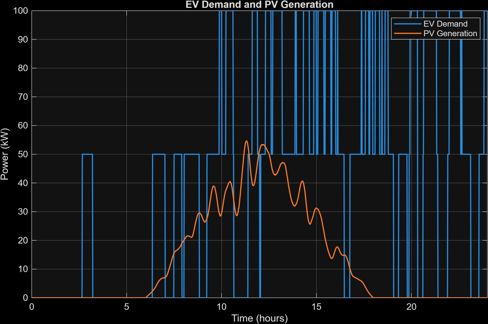
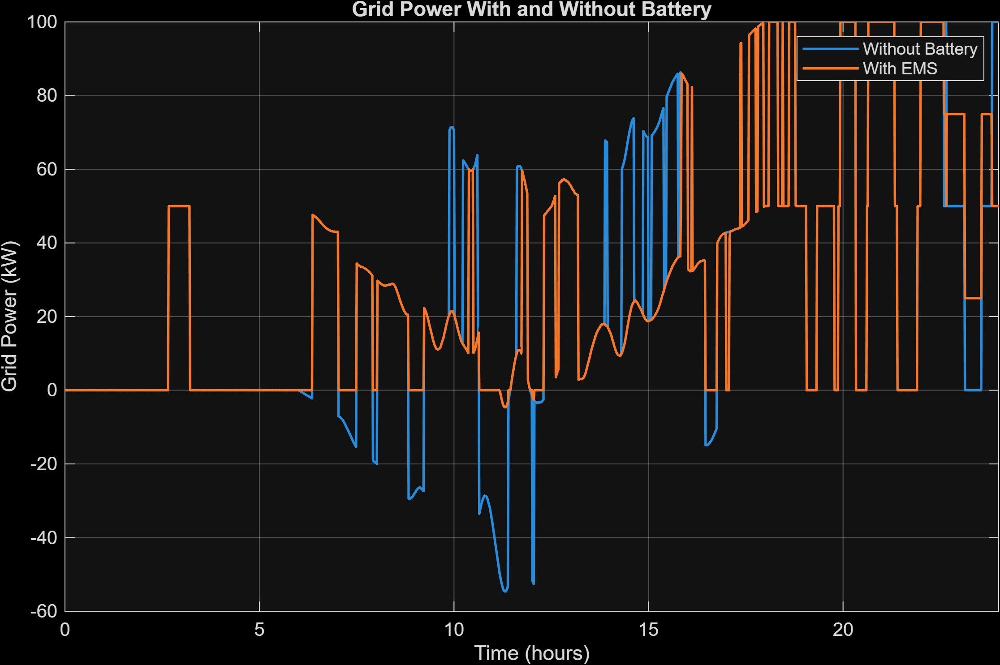
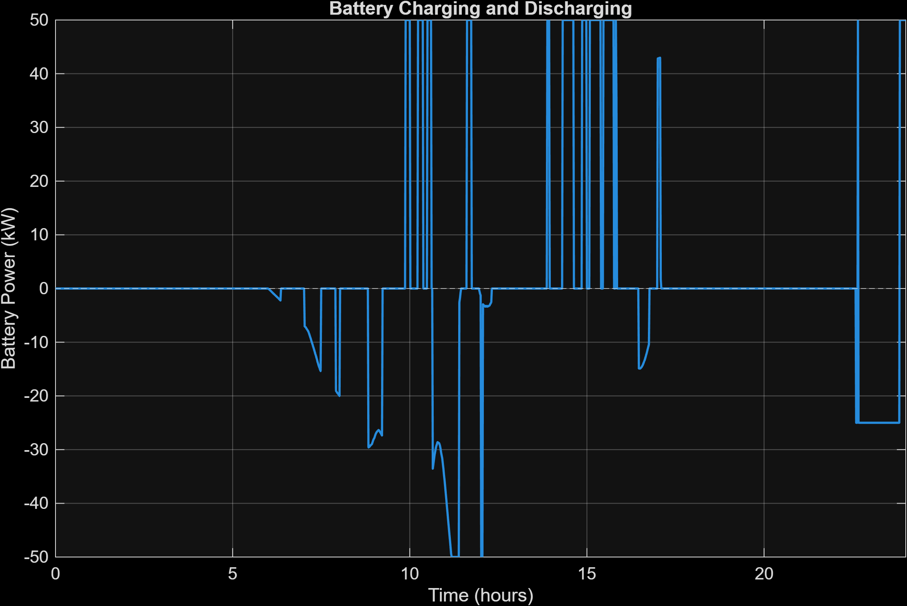
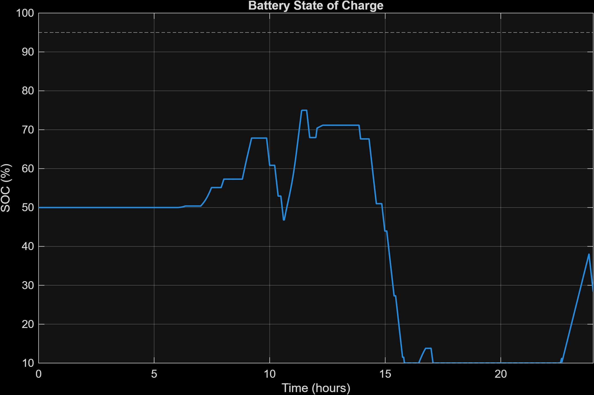

# Energy Management System for a PV–Battery–EV Charging Microgrid

A MATLAB/Simulink project exploring how battery storage and a simple rule-based energy management system (EMS) can reduce electricity costs in a grid-connected EV charging station.

## About the Project

I developed this project to explore the interaction between solar generation, battery storage, and electric vehicle charging demand.

The main idea was to build a microgrid model and implement an EMS that decides when the battery should charge or discharge based on the available PV power, EV demand, electricity prices, and battery state of charge (SOC).

I also wanted to compare the system's electricity costs with and without battery storage to see how much difference a relatively simple control strategy could make.

The project was developed in MATLAB and Simulink, using a 24-hour simulation with a one-minute time step.

## System Setup

The microgrid consists of:

- **PV system:** 60 kW peak generation
- **Battery:** 100 kWh capacity, with a maximum charging/discharging power of 50 kW
- **EV charging:** Two 50 kW chargers
- **Grid connection:** Supplies the remaining demand or receives excess power
- **EMS controller:** Manages battery operation using predefined rules

The battery operates between 10% and 95% SOC, with an initial SOC of 50%. Charging and discharging efficiencies are both assumed to be 95%.

The grid power is calculated as:

**Pgrid = Pev − Ppv − Pbattery**

Here, positive battery power means discharging, while negative power means charging.

Both PV generation and EV charging demand are represented by synthetic daily profiles.

## Energy Management Strategy

Rather than starting with an optimization algorithm, I decided to implement a rule-based controller first.

The controller follows a few basic principles:

1. **Use excess solar power:** When PV generation exceeds EV demand, the battery charges using the available surplus.
2. **Reduce expensive grid consumption:** During high-price periods, the battery discharges to reduce electricity purchases.
3. **Limit grid demand:** When net demand exceeds the 60 kW grid power target, the battery provides additional power when possible.
4. **Charge during cheaper hours:** The controller allows grid charging during low-price periods when the battery SOC is below 50%.
5. **Respect battery limits:** Charging and discharging commands are restricted by the battery's power and SOC limits.

The electricity tariff used in the simulation is:

| Period | Price |
|---|---:|
| Off-peak | €0.20/kWh |
| Normal | €0.30/kWh |
| Peak | €0.45/kWh |
| Grid export | €0.08/kWh |

These are assumed prices used to evaluate the controller, not actual electricity tariffs.

## Simulation Results

I compared two scenarios using the same PV generation and EV charging profiles:

- **Baseline:** PV generation and EV charging without battery storage.
- **EMS:** The same system with battery storage controlled by the EMS.

The results for the simulated day were:

| Metric | Result |
|---|---:|
| Electricity cost without battery | €240.55 |
| Electricity cost with EMS | €222.38 |
| Daily cost difference | €18.17 |
| Cost reduction | 7.55% |
| Maximum grid import | 100 kW |
| Minimum battery SOC | 10% |
| Maximum battery SOC | 75.01% |
| Final battery SOC | 29.25% |

The EMS reduced the calculated electricity cost by **7.55% for the simulated day**.

However, there is an important limitation to this comparison: the battery starts at 50% SOC and finishes at 29.25%.

This means some of the savings come from using energy already stored in the battery. The reported 7.55% reduction is therefore an unadjusted result, not a measure of repeatable daily savings.

A fairer long-term comparison would require the battery to finish at approximately the same SOC or account for the cost of restoring its initial energy.

### PV Generation and EV Demand



The PV and EV profiles represent a typical daily operating scenario, with changing solar availability and charging demand throughout the day.

### Grid Power Comparison



This figure compares grid power with and without battery storage.

### Battery Power



Positive values indicate battery discharging, while negative values indicate charging.

### Battery State of Charge



The SOC profile shows how the battery responds to the controller throughout the simulation.

## Model Validation

To check the simulation, I independently calculated the electricity cost in MATLAB using the simulated grid power and electricity price profiles.

The independent calculation matched the Simulink result.

I also checked the electrical power balance:

**Pgrid = Pev − Ppv − Pbattery**

The maximum numerical power balance error was effectively zero.

The battery SOC remained within its defined limits, and repeated runs produced identical results.

These checks helped confirm that the model and cost calculations were consistent for the tested scenario.

## Project Structure

```text
PV-Battery-EV-Microgrid-EMS/
│
├── models/
│   └── microgrid_v1.slx
│
├── scripts/
│   ├── main.m
│   ├── params.m
│   ├── make_day.m
│   ├── make_inputs.m
│   ├── ems_rule.m
│   ├── battery_step.m
│   └── cost_rate.m
│
├── results/
│   ├── EV_PV_Profile.png
│   ├── Grid_Comparison.png
│   ├── Battery_Power.png
│   └── Battery_SOC.png
│
└── README.md
```

## How to Run

The project requires MATLAB and Simulink.

1. Download or clone the repository.
2. Open MATLAB and navigate to the project directory.
3. Run:

```matlab
run('scripts/main.m')
```

The script generates the input profiles, runs the Simulink model, and calculates the electricity costs and validation results.

## What I Would Improve Next

This is an initial EMS prototype, and there are several areas I would like to explore further.

The first improvement would be to introduce a terminal SOC constraint so that the economic comparison accounts for the battery's stored energy at the end of the simulation.

I would also like to test the controller over multiple days and compare the rule-based strategy with an optimization-based approach, such as Model Predictive Control (MPC).

Other possible improvements include battery degradation modeling and more realistic EV charging and PV generation profiles.

## Tools Used

- MATLAB
- Simulink

**Main topics:** Energy management, power systems, battery storage, photovoltaic generation, EV charging, and rule-based control.
